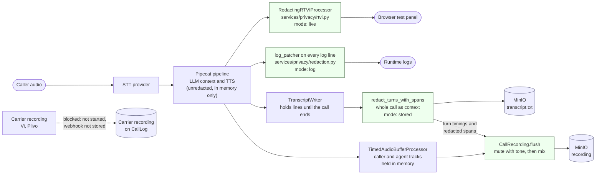
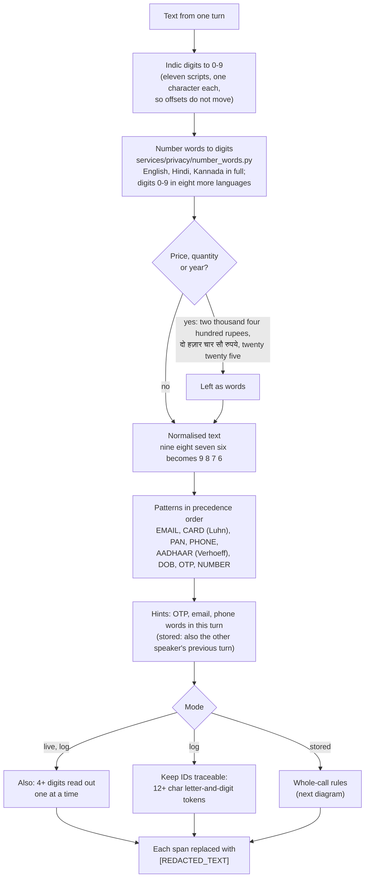
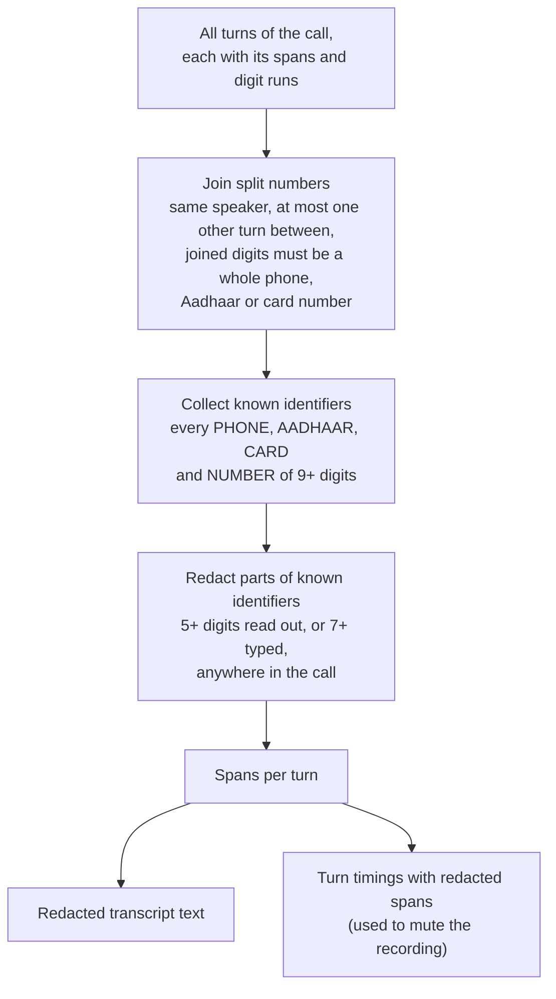
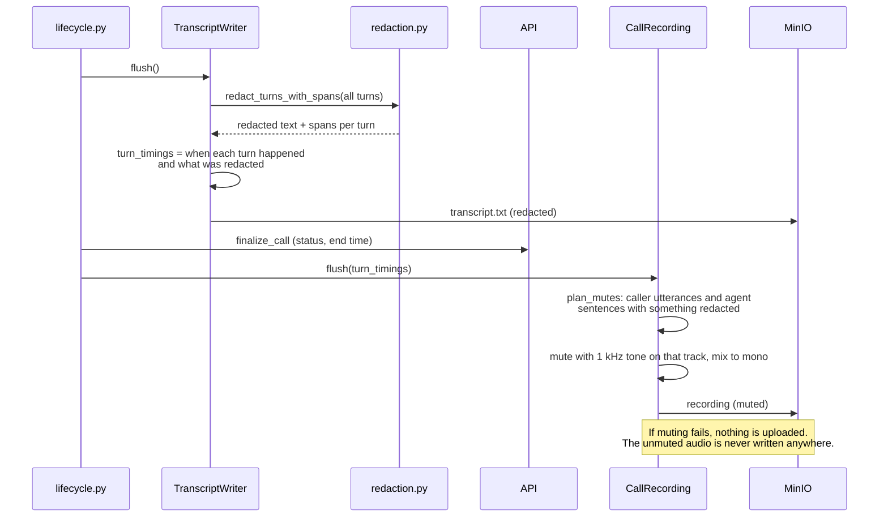
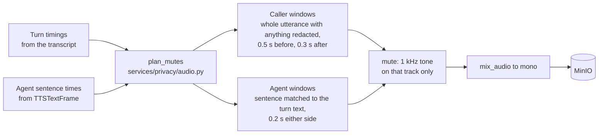

# PII redaction: architecture

How the runtime keeps personal details (phone, Aadhaar, card, PAN, email, date of birth, OTP, long numbers) out of what it shows, logs and stores. For the settings and what is detected, see [Redacting PII in transcripts](../guides/operator/operations.md#redacting-pii-in-transcripts) and [Call recordings](../guides/operator/operations.md#call-recordings).

Everything here applies only with `PII_REDACTION_ENABLED=true`. With it off, nothing is redacted and recording works as before.

## Where redaction happens

The speech recognition, LLM and TTS providers work on the real text: the agent has to understand the caller. Redaction applies at every point where text or audio leaves the call: the test panel, the logs, the stored transcript and the stored recording.

| Path | Code | Mode | When |
| --- | --- | --- | --- |
| Test panel | `services/privacy/rtvi.py` (`RedactingRTVIProcessor`, added in `services/pipecat/factory.py`) | `live` | Each `user-transcription` and `bot-output` message. The streamed `bot-llm-text`, `bot-tts-text` and `bot-transcription` messages are dropped. |
| Runtime logs | `log_patcher` in `services/privacy/redaction.py`, installed in `apps/runtime/app.py` | `log` | Every log line, including Pipecat's and the STT adapters', and exception tracebacks (written without local variables). |
| Stored transcript | `services/storage/transcript.py` (`TranscriptWriter.render`) | `stored` | Once, at call end, over all turns together. |
| System recording | `services/storage/recording.py`, `services/privacy/audio.py` | uses the transcript's spans | At call end, after the transcript. |
| Carrier recording | `routes/telephony.py`, `routes/provider_recording.py`, `routes/plivo_telephony.py` | none | Not started, and webhooks are acknowledged with `200` and not stored, while redaction is on. |

## How one piece of text is redacted

`redact_text` (one line) and `redact_turns_with_spans` (a whole call) share the same steps. The text is rewritten into a normalised copy for matching; every match maps back to the original text, so only the original span is replaced.

The placeholder is the same for every type, so a reader cannot tell what kind of detail was removed.

## Whole-call rules (stored transcript only)

Run by `_analyse_turns` in `services/privacy/redaction.py` after every turn has been through the steps above.

A phone hint (`number`, `mobile`, `नंबर`, `ಮೊಬೈಲ್`, ...) in a turn or in the same speaker's previous turn lets digits typed in an unusual grouping count as a phone, and lets a grouped part (`76 54 32 10`) join with the rest of the number.

## Call end

The order matters: the recording is muted from what the transcript redaction found, so the transcript goes first. From `run_with_lifecycle` in `services/pipecat/lifecycle.py`:

Failure handling:

- **Transcript redaction fails.** Each line falls back to the stricter `live` redaction, and every turn is marked for muting, so the recording is muted throughout.
- **Muting fails.** The recording is not stored at all.
- **A log line fails to redact.** It is written as `[REDACTION_FAILED]`, without its traceback.

## Muting the recording

`TimedAudioBufferProcessor` (`services/storage/recording.py`) records the caller and agent on separate tracks, on one clock that starts with the first audio frame. For each `TTSTextFrame` it notes when that agent sentence was spoken.

The recording keeps its full length, so transcript timestamps still line up with it.

## Settings

| `CALL_RECORDING_ENABLED` | `PII_REDACTION_ENABLED` | Test panel, logs, transcript | System recording | Carrier recording |
| --- | --- | --- | --- | --- |
| `true` (default) | `false` (default) | Not redacted | Stored as recorded | Stored |
| `true` | `true` | Redacted | Stored with PII muted | Not started or stored |
| `false` | any | As per `PII_REDACTION_ENABLED` | Not recorded | Not started or stored |

## Limits

- What is not detected (names, postal addresses, Hindi numbers typed in English letters) is not redacted or muted.
- If the speech recognition mishears a number, the transcript holds the wrong words, and neither redaction nor muting can catch it.
- The STT, LLM and TTS providers receive the real text and audio. Their own logging and retention are governed by each provider.

## Code map

| File | Role |
| --- | --- |
| `apps/runtime/services/privacy/redaction.py` | Patterns, modes, whole-call rules, log patcher |
| `apps/runtime/services/privacy/number_words.py` | Number words and Indic digits to digits; prices and quantities left alone |
| `apps/runtime/services/privacy/rtvi.py` | Test panel redaction |
| `apps/runtime/services/privacy/audio.py` | Recording switches, turn timings, mute planning, tone |
| `apps/runtime/services/storage/transcript.py` | Transcript buffering, redaction at call end, turn timings |
| `apps/runtime/services/storage/recording.py` | Timed recorder, muted upload |
| `apps/runtime/services/pipecat/lifecycle.py` | Call-end order |
| `apps/runtime/tests/test_pii_redaction.py`, `test_recording_redaction.py` | Tests |
